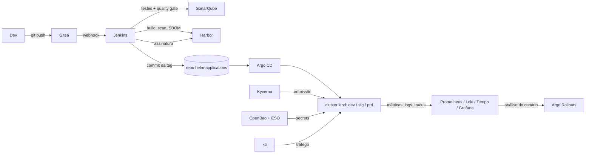

# Lab Cloud Native de CI/CD

[English](README.md)

Este lab simula uma plataforma de CI/CD de produção em um único computador.
Usa os mesmos padrões de grandes plataformas Kubernetes.
Roda no [kind](https://kind.sigs.k8s.io/) (Kubernetes em Docker) com nomes `*.localhost.com`.

Um comando cria o lab inteiro do zero.
Tudo é código: Argo CD, values do Helm, Terraform e Jenkins Configuration as Code.
Não há passo manual nas interfaces.

## Objetivo

- Mostrar o fluxo completo de entrega: commit, teste, scan, assinatura, deploy, promoção, observação.
- Usar ferramentas e padrões cloud native de mercado.
- Recriar o mesmo lab sempre (`make down && make up`).

## O que o lab inclui

| Área | Ferramentas | O que faz |
|---|---|---|
| GitOps | Argo CD (app of apps, ApplicationSet, sync waves) | Aplica todos os manifests da plataforma e dos apps a partir do Git |
| Código-fonte | Gitea | Hospeda os repos dos apps, os charts Helm e a shared library do Jenkins |
| CI | Jenkins (JCasC, agents no Kubernetes, shared library) | Roda um pipeline gitflow por tipo de branch |
| Qualidade | SonarQube, testes unitários, cobertura | Para o pipeline quando o quality gate falha |
| Imagens | Kaniko, Harbor | Constrói a imagem uma vez e promove entre ambientes (sem rebuild) |
| Supply chain | Scan do Harbor (Trivy), SBOM, cosign, Kyverno | Escaneia e assina cada imagem; o Kyverno bloqueia imagem sem assinatura |
| Políticas | Kyverno (políticas CEL) | Exige resources, non-root, registries aprovados, sem tag `latest` |
| Secrets | OpenBao, External Secrets Operator | Guarda as senhas num cofre; isola cada ambiente |
| Entrega | Argo Rollouts, AnalysisTemplate | Canário; a análise no Prometheus promove ou aborta |
| Escala | metrics-server, HPA | Escala a API por CPU |
| Observabilidade | Prometheus, Grafana, Loki, Alloy, Tempo, OpenTelemetry | Métricas, logs e traces com links entre eles |
| Confiabilidade | Pyrra (SLI/SLO), Alertmanager, métricas DORA | Error budget, alertas de burn rate e métricas de entrega |
| Carga | k6 | Tráfego controlado em dev o tempo todo (stg sob demanda) |
| Infraestrutura como código | Terraform | Configura Gitea, Harbor, SonarQube, credentials do Jenkins e OpenBao |
| Rede | MetalLB, Traefik, CoreDNS | Um IP fixo para todos os nomes `*.localhost.com` |

## Arquitetura



## Fluxo do pipeline (gitflow)

A shared library (`gitflowPipeline`) roda só os stages de cada tipo de branch.

| Branch | Stages | Ambiente |
|---|---|---|
| `feature-*` | Testes, SonarQube | Nenhum |
| `develop` | Testes, SonarQube, build, scan do Harbor, assinatura cosign, teste de infra, deploy, smoke test | dev |
| `release-vX.Y.Z` | Testes, SonarQube, promoção da imagem, deploy, aprovação cria a tag | stg |
| `hotfix-vX.Y.Z` | Testes, SonarQube, build, scan, assinatura, teste de infra, deploy, aprovação cria a tag | stg |
| tag `vX.Y.Z` | Promoção da imagem, aprovação, deploy, release no Gitea, merge em `main` e `develop` | prd |

Deploy é um commit da tag da imagem no repo `helm-applications`.
O Argo CD aplica a mudança.
Se o smoke test falha, o pipeline reverte o commit e registra um evento de falha DORA.

## Prints

| | |
|---|---|
|  Front end em dev: selo do ambiente e versões do front e da API. |  Front end em prd com a release `v1.0.0`. |
|  Gitea: repos das apps, charts Helm e shared library, criados pelo Terraform. |  Jenkins: um job multibranch por app. |
|  Jenkins: branches do gitflow com cobertura. |  Jenkins: pipeline do `develop`, dos testes ao smoke test. |
|  Jenkins: pipeline da tag, promoção para prd, release no Gitea e merge de volta. |  SonarQube: quality gate e cobertura de cada branch. |
|  Harbor: projeto com as imagens das apps. |  Harbor: uma imagem para dev, stg e prd, com scan, assinatura cosign e SBOM. |
|  Argo CD: todas as applications Synced e Healthy. |  Argo Rollouts: passos do canário e análise na extensão do Argo CD. |
|  OpenBao: segredos por ambiente. |  Traefik: routers e services, com tracing OTLP e access log. |
|  Grafana: dashboard RED com exemplars, MongoDB, service graph e traces. |  Tempo: uma requisição do Traefik até a API e o MongoDB. |
|  Grafana: logs de cada serviço no Loki. |  Prometheus: métricas do cluster. |
|  Alertmanager: só o alerta Watchdog ativo. |  Pyrra: SLOs de disponibilidade e latência por ambiente. |
|  Pyrra: SLO de latência e error budget. |  Grafana: métricas DORA a partir dos eventos do pipeline. |

## Requisitos

| Item | Valor |
|---|---|
| Sistema | Linux com Docker (testado no Ubuntu) |
| Memória | 16 GB de RAM livre no mínimo (o lab usa ~13 GB) |
| CPU | 8 cores recomendados |
| Disco | 40 GB livres |
| Internet | Necessária (imagens, charts, plugins do Jenkins) |
| Ferramentas | `docker`, `kind`, `kubectl`, `helm`, `jq`, `terraform`, `openssl` (`gh` opcional) |
| Acesso | `sudo` para o `/etc/hosts` e os limites de inotify |

## Como executar

### 1. Ajuste os limites do kernel

O kind compartilha o kernel do host.
Limites baixos de inotify causam o erro `too many open files` nos pods.

```bash
sudo sysctl -w fs.inotify.max_user_instances=512 fs.inotify.max_user_watches=524288
printf 'fs.inotify.max_user_instances = 512\nfs.inotify.max_user_watches = 524288\n' | sudo tee /etc/sysctl.d/99-kind.conf
```

### 2. Confira a rede do Docker

O lab dá ao Traefik o IP fixo `172.18.0.50`.
Esse IP precisa estar na subnet da rede Docker `kind`.

```bash
docker network inspect kind -f '{{(index .IPAM.Config 0).Subnet}}'
```

Se o resultado não for `172.18.0.0/16`, troque o IP nestes arquivos:

- `Makefile` (`LB_IP`)
- `manifests/metallb-pool.yaml` (pool de endereços)
- `manifests/setup-hosts.yaml` (hosts dos nodes)
- `values/traefik/traefik-values.yaml` (`metallb.io/loadBalancerIPs`)

Se a rede ainda não existe, rode `make create-cluster` antes e confira de novo.

### 3. Defina o repositório Git

O Argo CD lê este repositório do GitHub.
Num fork, troque `GIT_REPO_URL` e `GITHUB_USER` no `Makefile`.
Troque também os campos `repoURL` em `argocd/`.
O Argo CD só aplica o que estiver no branch `main` (faça push).

Repositório público não precisa de credencial.
Num repositório privado, o Argo CD precisa de um token do GitHub com leitura no repositório.
Use um fine-grained personal access token com a permissão `Contents: Read-only`.

```bash
export GH_TOKEN=<token>
```

Sem `GH_TOKEN`, o `make up` usa `gh auth token` (se o GitHub CLI estiver logado).
O token vai só para o Secret `argocd-repo-creds` do Kubernetes. Não é gravado em arquivo.

### 4. Suba o lab

```bash
make up
```

O comando faz estes passos:

1. Confere as ferramentas e os limites de inotify.
2. Adiciona os nomes `*.localhost.com` no `/etc/hosts` (pede `sudo`).
3. Cria o cluster kind (1 control plane, 2 workers).
4. Instala o Argo CD e aplica os root apps.
5. Espera a plataforma (primeira subida: ~15 a 20 minutos).
6. Roda o Terraform (Gitea, Harbor, SonarQube, credentials do Jenkins, OpenBao).
7. Envia os repos dos apps para o Gitea. Os primeiros pipelines começam.

dev recebe as primeiras imagens pelos pipelines do `develop` (~10 minutos).
stg e prd ficam sem pods até o primeiro release.
Para fazer um release, crie a branch `release-v1.0.0` a partir de `develop` no Gitea e aprove o pipeline no Jenkins.

### 5. Acesse as ferramentas

```bash
make passwords
```

A senha padrão de todas as ferramentas é `DevOps@123456`.
Para outra senha, rode `make up PASSWORD=<valor>`.
O OpenBao guarda a senha depois da primeira subida.
Exceção: o Argo CD usa um hash bcrypt fixo em `values/argocd/argocd-values.yaml`.

| URL | Ferramenta |
|---|---|
| http://argocd.localhost.com | Argo CD |
| http://jenkins.localhost.com | Jenkins |
| http://gitea.localhost.com | Gitea |
| http://harbor.localhost.com | Harbor |
| http://sonarqube.localhost.com | SonarQube |
| http://grafana.localhost.com | Grafana |
| http://prometheus.localhost.com | Prometheus |
| http://alertmanager.localhost.com | Alertmanager |
| http://pyrra.localhost.com | Pyrra (SLO) |
| http://openbao.localhost.com | OpenBao (método: Username) |
| http://app-dev.localhost.com, app-stg, app | Front (dev, stg, prd) |
| http://api-dev.localhost.com, api-stg, api | API (dev, stg, prd) |

### 6. Dia a dia

| Comando | Resultado |
|---|---|
| `make stop` / `make start` | Para ou religa os nodes, sem perder estado |
| `make traffic-on` / `make traffic-off` | Liga ou desliga a carga k6 em stg |
| `make config-plan` | Mostra as mudanças do Terraform |
| `make down` | Apaga o cluster e o state do Terraform |
| `make help` | Lista todos os alvos |

## Estrutura do repositório

| Diretório | Conteúdo |
|---|---|
| `cluster/` | Configuração do kind |
| `argocd/root/` | Root apps (aplicados uma vez pelo `make bootstrap`) |
| `argocd/argocd-apps/` | Apps da plataforma (ordem por sync wave) |
| `argocd/applications/` | ApplicationSet dos apps do pipeline (app x ambiente) |
| `argocd/argocd-appprojects/` | AppProjects |
| `values/<ferramenta>/` | Overrides de values de cada chart |
| `manifests/` | Pool do MetalLB, rewrite do CoreDNS, hosts dos nodes e registry do Harbor |
| `monitoring/` | Dashboards, ServiceMonitors e alertas como código |
| `policies/` | Políticas do Kyverno |
| `pyrra/` | Definições de SLO |
| `secrets/` | ClusterSecretStore e ExternalSecrets da plataforma |
| `loadgen/` | Script e deployments do k6 |
| `terraform/` | Configuração das ferramentas depois do deploy |
| `repos/` | Conteúdo inicial dos repos do Gitea (API, front, shared library, charts) |

## Limites do lab

O lab simula padrões de produção. Não é uma plataforma de produção.

| Tema | No lab | Em produção |
|---|---|---|
| Cluster | Um cluster kind num computador | Cluster gerenciado em várias zonas |
| Disponibilidade | Uma réplica na maioria dos componentes | Alta disponibilidade em cada componente |
| TLS | Só HTTP; Harbor como registry inseguro | TLS em todos os endpoints (ex.: cert-manager) |
| DNS | `/etc/hosts` e rewrite no CoreDNS | Zona DNS real |
| Unseal do cofre | Chave estática num Secret do Kubernetes | KMS de nuvem ou HSM |
| State do Terraform | Arquivo local com secrets em texto puro | Backend remoto e criptografado |
| Secrets do Terraform | Chave SSH, chave cosign, robot do Harbor e token do Sonar são Secrets do Kubernetes | Secrets no cofre |
| Assinatura | Par de chaves cosign, sem log de transparência (Rekor) | Keyless ou chave em KMS, com Rekor |
| Alertas | Visíveis no Alertmanager e Grafana, sem notificação | Roteados para ferramentas de plantão |
| Janela de SLO | 7 dias | 28 ou 30 dias |
| Backup | Nenhum | Backup e testes de restore (ex.: Velero) |
| Acesso do pipeline | ServiceAccount do pipeline é cluster-admin | Menor privilégio |
| Plugins do Jenkins | Baixados da internet na primeira subida | Imagem com os plugins embutidos |

## Próximos passos possíveis

- Chaos Mesh: injetar falhas e conferir probes, canário, SLOs e alertas.
- Renovate: pull requests automáticos de charts, imagens e plugins.
- KEDA ou prometheus-adapter: escalar por requests por segundo.
- cert-manager com a PKI do OpenBao: HTTPS em todos os endpoints.
- Secrets do Terraform no OpenBao.
